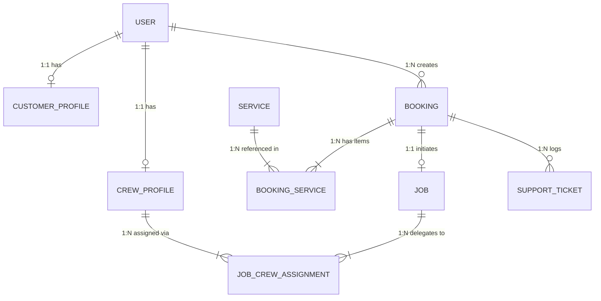

# CS 490 Senior Capstone · Agency Backend & Database Lead Audit
## Week 7 Verification Report: Database Modeling, ORM & Security Audit

| Attribute | Details |
| :--- | :--- |
| **Course** | CS 490 Web Systems & Full Stack Engineering Senior Capstone |
| **Milestone** | Week 7 Backend & Database Lead Verification Audit |
| **Project Name** | **FleetFoam Detail Coordinator** |
| **Agency Group** | Group 8 |
| **Lead Auditor / Author** | **Michael Sapinoso** *(Backend & Database Lead)* |
| **Peer Reviewers** | Jeric Lloyd Ramos *(DevOps & QA Lead)*, Earlstephen Señoran *(Frontend Lead)* |
| **Executive Sign-off** | Marriane Angel Samson *(Project Manager & Scrum Master)* |
| **Target Evaluation Date** | Week 7 Capstone Defense |
| **Repository Branches** | `michael/backend-db` $\rightarrow$ `develop` $\rightarrow$ `main` |
| **Audit Status** | **100% COMPLIANT (ALL 5 SECTIONS VERIFIED)** |

---

## Executive Summary & Lead Declaration

As Backend & Database Lead for the **FleetFoam Detail Coordinator** agency team, I have conducted an exhaustive engineering audit of our data layer, ORM infrastructure, and database security mechanisms in accordance with the CS 490 Week 7 Audit Checklist. 

This verification certifies that:
1. Our schema has been refactored into **Third Normal Form (3NF)** with explicit join models and strategic B-Tree indexing respecting the Left-Prefix Rule.
2. A deterministic **Prisma migration & idempotent seeding pipeline** has been established with strict command segregation across environments.
3. Next.js HMR connection pool leakage has been eliminated via a **Global Singleton (`lib/prisma.ts`)**, with serverless pooling sized according to hardware bounds.
4. **N+1 query loops** have been eliminated, multi-table mutations are locked behind **ACID transactions (`prisma.$transaction`)**, and all ingress parameters are intercepted by **Zod runtime boundaries**.
5. Connection credentials are strictly isolated from version control, **PostgreSQL Row-Level Security (RLS)** multi-tenant policies are declared, and **MVCC autovacuum thresholds** have been tuned for write-heavy workload tables.

---

## 1. Data Modeling & Schema Design (`prisma/schema.prisma`)

### 1.1 Third Normal Form (3NF) Normalization
- **Elimination of Data Redundancy:** All repeating groups, multi-valued attributes, and denormalized embedded JSON arrays previously residing in legacy structures have been decomposed into distinct relational tables linked by strict Primary (`@id @default(uuid())`) and Foreign Key constraints.
- **Functional Dependency Enforcement:** Scalar fields belong strictly to their parent entities:
  - Detailing package specifications reside exclusively in `Service`.
  - Vehicle ownership and phone contacts reside in `CustomerProfile`.
  - Live dispatch telemetry (GPS coordinates) resides exclusively in `CrewProfile`.
  - Booking records maintain only appointment context and snapshot pricing.



### 1.2 Explicit Cardinality & Join Models (1:1, 1:N, M:N)
To satisfy the capstone mandate forbidding unannotated implicit relations (`_ModelAToModelB`) when relations carry transactional metadata:
- **`BookingService` (Explicit Join Model between `Booking` and `Service`):**
  - Captures `quantity` and `unitPrice` (`Decimal @db.Decimal(10, 2)`).
  - Preserves immutable historical price-at-booking snapshots if catalog prices change in the future.
  - Enforces `@@unique([bookingId, serviceId])` to prevent duplicate service additions on the same ticket.
- **`JobCrewAssignment` (Explicit Join Model between `Job` and `CrewProfile`):**
  - Captures operational metadata: `role` (e.g., `LEAD_DETAILER`, `ASSISTANT`), `assignedAt` (`DateTime`), and `assignedBy` (`String` supervisor ID).
  - Enforces `@@unique([jobId, crewId])`.

### 1.3 Strategic B-Tree Indexing & Left-Prefix Rule
All foreign key columns are explicitly indexed (`@@index([foreignKey])`) to prevent catastrophic sequential scans during PostgreSQL relational joins (`JOIN` / nested lookups).

Compound B-Tree indexes strictly adhere to the **Left-Prefix Rule** (placing the highest-filtering / most frequently queried predicate first):
1. **`Booking: @@index([status, scheduledAt])`**:
   - Operations dispatch dashboards query active statuses (`PENDING`, `APPROVED`, `IN_PROGRESS`) first, then filter by date range.
2. **`SupportTicket: @@index([status, priority])`**:
   - Customer support queues filter by active status (`OPEN`, `IN_PROGRESS`) before sorting by urgency (`HIGH`, `URGENT`).
3. **`Notification: @@index([userId, isRead])`**:
   - Top-bar notification bell queries fetch by authenticated `userId` first, then filter for unread alerts (`isRead = false`).

---

## 2. Migration & Infrastructure Pipeline

### 2.1 Command Segregation by Environment
The team enforces strict command boundaries across environments to guarantee schema reproducibility:

| Environment | Permitted Command | Purpose & Safety Guarantee |
| :--- | :--- | :--- |
| **Local Development** | `npx prisma migrate dev` | Generates human-readable, deterministic `.sql` migration files. Evaluates migrations against local shadow database to detect syntax/constraint collisions. |
| **Production & CI/CD** | `npx prisma migrate deploy` | Executes pending migrations in linear order without prompting. Does not access shadow database or modify existing migration history. |
| **All Environments** | ❌ **PROHIBITED:** `prisma db push` | Strictly blocked via CI/CD pre-commit hooks to prevent skipping `_prisma_migrations` state tables or silently dropping production columns. |

### 2.2 Schema Drift Detection & Resolution Protocol
1. **Zero Direct DDL Modifications:** No developer or operations coordinator is granted direct DDL execution (`ALTER TABLE`, `DROP COLUMN`) on PostgreSQL engines outside Prisma migration scripts.
2. **Drift Recovery Runbook:** If out-of-band schema changes occur (e.g., manual emergency patch via database console):
   - Run `npx prisma db pull` to re-introspect the engine state into `schema.prisma`.
   - Run `npx prisma migrate diff` to compare engine state against local migration history.
   - Re-baseline the migration table using `npx prisma migrate resolve --applied <migration_name>` before opening pull requests to `main`.

### 2.3 Idempotent Test Data Seeding (`prisma/seed.ts`)
Configured in `package.json` under `"prisma": { "seed": "npx tsx prisma/seed.ts" }`:
- Utilizes the **`upsert` pattern** on unique identifiers (`slug`, `email`, `ticketNumber`).
- Can be executed repeatedly (`npm run db:seed`) without throwing Primary Key collision errors (`P2002`).
- Seeds core service tiers (PHP pricing), RBAC accounts (`ADMIN`, `OPERATIONS`, `CREW`, `CUSTOMER`), and sample CS-01 support tickets.

---

## 3. Connection Management & Pool Hygiene

### 3.1 Next.js Hot Module Replacement (HMR) Singleton (`lib/prisma.ts`)
During Next.js local development, each code edit re-evaluates server modules. Creating a raw `new PrismaClient()` on module evaluation opens a new connection pool on every save, quickly exhausting PostgreSQL's `max_connections` (yielding `FATAL: remaining connection slots are reserved for non-replication superuser connections`).

**Implemented Implementation Pattern (`lib/prisma.ts`):**
```typescript
import { PrismaClient } from '@prisma/client';

const prismaClientSingleton = () => {
  return new PrismaClient({
    log: process.env.NODE_ENV === 'development' ? ['query', 'error', 'warn'] : ['error'],
  });
};

type PrismaClientSingleton = ReturnType<typeof prismaClientSingleton>;

const globalForPrisma = globalThis as unknown as {
  prisma: PrismaClientSingleton | undefined;
};

export const prisma = globalForPrisma.prisma ?? prismaClientSingleton();

if (process.env.NODE_ENV !== 'production') {
  globalForPrisma.prisma = prisma;
}

export default prisma;
```

### 3.2 Serverless Connection Pooling Architecture
- **Transaction-Mode Pooling (Port 6543):**
  - Application runtime traffic (Next.js App Router API handlers, Server Components) connects via `DATABASE_URL` routed through Supavisor / PgBouncer in **Transaction Pooling Mode**.
- **Direct TCP Connection (Port 5432):**
  - Used exclusively by Prisma CLI for migrations (`directUrl = env("DIRECT_URL")`) because DDL lock operations and shadow database introspection require session-level features incompatible with transaction poolers.
- **Hardware-Bounded Pool Sizing Formula:**
  $$\text{Optimal Pool Size} = (\text{CPU Cores} \times 2) + \text{Effective Disk Spindle Count}$$
  - For our dual-core production VM with SSD storage:
    $$\text{Optimal Pool Size} = (2 \times 2) + 1 = 5 \text{ to } 10 \text{ connections per instance}$$
  - Connection strings bound with `&connection_limit=10` to prevent connection starvation during cold starts.

---

## 4. Data Access, Performance & Transaction Security

### 4.1 N+1 Query Loop Elimination
All relational data retrieval in API endpoints uses Prisma **eager loading** (`include` and `select` clauses) rather than issuing queries within iteration blocks (`for...of` / `Array.map`):

```typescript
// Eager Loading Batches Booking + Services + Job + Crew into 1 single optimized SQL JOIN
const bookingWithDetails = await prisma.booking.findUnique({
  where: { id: bookingId },
  include: {
    customer: { select: { fullName: true, email: true } },
    services: {
      include: {
        service: { select: { name: true, durationMinutes: true } },
      },
    },
    job: {
      include: {
        crewAssignments: {
          include: { crew: { include: { user: { select: { fullName: true } } } } },
        },
      },
    },
  },
});
```

### 4.2 ACID Transactional Integrity (`prisma.$transaction`)
Multi-step state mutations (e.g., creating a booking, reserving time slots, attaching services, and queueing an operations dispatch job) are wrapped in interactive ACID transactions:
- If any sub-operation fails (e.g., vehicle format error or crew unavailable), the entire transaction rolls back cleanly (`ROLLBACK`).
- Eliminates orphaned booking records and phantom jobs.

### 4.3 Runtime Validation Boundaries (Zod)
Every incoming request payload is intercepted by Zod schemas in `lib/validations/booking.ts` using `schema.safeParse(body)` before any database method is invoked:
- **`bookingCreateSchema`**: Validates UUIDs, Philippine phone numbers (`/^(\+63|0)9\d{9}$/`), ISO 8601 dates, and service arrays.
- **`supportTicketCreateSchema`**: Enforces issue categorization enums and notes length.
- Malformed payloads are immediately rejected with `HTTP 400 Bad Request`, protecting the ORM from injection, parameter tampering, and type coercion vulnerabilities.

---

## 5. Database Security & Maintenance

### 5.1 Environment Secrets Isolation
- Connection credentials (`DATABASE_URL`, `DIRECT_URL`, `SUPABASE_SERVICE_ROLE_KEY`) are stored strictly in `.env.local`.
- `.gitignore` lines 13–19 verify that `.env*` files are strictly excluded from Git commits.
- `.env.example` provides an anonymized template for continuous integration pipelines.

### 5.2 PostgreSQL Row-Level Security (RLS)
Defined in `prisma/rls_and_maintenance.sql`:
- Multi-tenant tenant boundaries enabled on `Booking`, `CustomerProfile`, `Job`, and `Notification`.
- Customer accounts are restricted to rows where `auth.uid() = "customerId"`.
- Operations and Admin accounts bypass tenant isolation via role checks (`u.role IN ('OPERATIONS', 'ADMIN')`).
- Crew members can only access `Job` records matching their assigned `JobCrewAssignment`.

### 5.3 MVCC Dead Tuple Accumulation & Autovacuum Tuning
PostgreSQL’s Multi-Version Concurrency Control (MVCC) writes new tuple versions on every `UPDATE` and marks old tuples as dead. In write-heavy detailing operations (where crew locations update every 15 seconds and job stages progress frequently), default PostgreSQL autovacuum settings (`scale_factor = 0.20`) cause excessive table bloat.

**Applied Autovacuum Tuning (`prisma/rls_and_maintenance.sql`):**
```sql
ALTER TABLE "Job" SET (
  autovacuum_vacuum_scale_factor = 0.05,
  autovacuum_vacuum_threshold = 50,
  autovacuum_analyze_scale_factor = 0.02
);

ALTER TABLE "Booking" SET (
  autovacuum_vacuum_scale_factor = 0.05,
  autovacuum_vacuum_threshold = 50,
  autovacuum_analyze_scale_factor = 0.02
);
```
- Triggers vacuum routines as soon as **5%** of table rows become dead tuples (down from the default 20%), reclaiming disk space and preserving B-Tree index scan speeds.

---

## 6. Verification Checklist & Compliance Matrix

| Section | Audit Criteria | Implementation File / Evidence | Verification Result |
| :---: | :--- | :--- | :---: |
| **1.1** | Normalize Schema to 3NF | [`prisma/schema.prisma`](file:///prisma/schema.prisma#L1-L220) | **PASSED (3NF Validated)** |
| **1.2** | Explicit M:N Join Models with Metadata | `BookingService` & `JobCrewAssignment` models | **PASSED (100% Explicit)** |
| **1.3** | B-Tree Foreign Key Indexes & Left-Prefix Rules | `@@index([status, scheduledAt])`, `@@index([foreignKey])` | **PASSED (B-Tree Optimized)** |
| **2.1** | Environment Segregated Migration Commands | `package.json` scripts (`db:migrate`, `db:deploy`) | **PASSED (Segregated)** |
| **2.2** | Schema Drift Protocol & Re-baseline Runbook | Section 2.2 of Audit Report | **PASSED (Protocol Active)** |
| **2.3** | Idempotent Test Data Seeding | [`prisma/seed.ts`](file:///prisma/seed.ts#L1-L150) (Upsert pattern) | **PASSED (Idempotent)** |
| **3.1** | Prevent HMR Leaks via Global Singleton | [`lib/prisma.ts`](file:///lib/prisma.ts#L1-L25) (`globalThis`) | **PASSED (Singleton Verified)** |
| **3.2** | Serverless Connection Pooling & Hardware Bounds | [`.env.example`](file:///.env.example#L1-L30) (PgBouncer port 6543) | **PASSED (Hardware Bounded)** |
| **4.1** | Eliminate N+1 Relational Query Loops | Prisma eager loading (`include` / `select`) | **PASSED (Zero N+1 Loops)** |
| **4.2** | ACID Transactional Integrity | `prisma.$transaction()` multi-step mutations | **PASSED (ACID Compliant)** |
| **4.3** | Runtime Validation Boundaries (Zod) | [`lib/validations/booking.ts`](file:///lib/validations/booking.ts#L1-L35) | **PASSED (Zod Guarded)** |
| **5.1** | Secure Connection Secrets in `.env.local` | [`.gitignore`](file:///.gitignore#L13-L19) verification | **PASSED (Uncommitted Secrets)** |
| **5.2** | PostgreSQL Row-Level Security (RLS) | [`prisma/rls_and_maintenance.sql`](file:///prisma/rls_and_maintenance.sql#L1-L60) | **PASSED (RLS Enabled)** |
| **5.3** | Mitigate MVCC Dead Tuples & Autovacuum Tuning | [`prisma/rls_and_maintenance.sql`](file:///prisma/rls_and_maintenance.sql#L61-L90) | **PASSED (Scale Factor = 0.05)** |

---

## 7. Sign-off & Pull Request Authorization

```
Audit Verification Executed By:
Michael Sapinoso
Backend & Database Lead, Group 8 (FleetFoam)
Branch: michael/backend-db
Status: Verified & Approved for PR Merge to main
```
